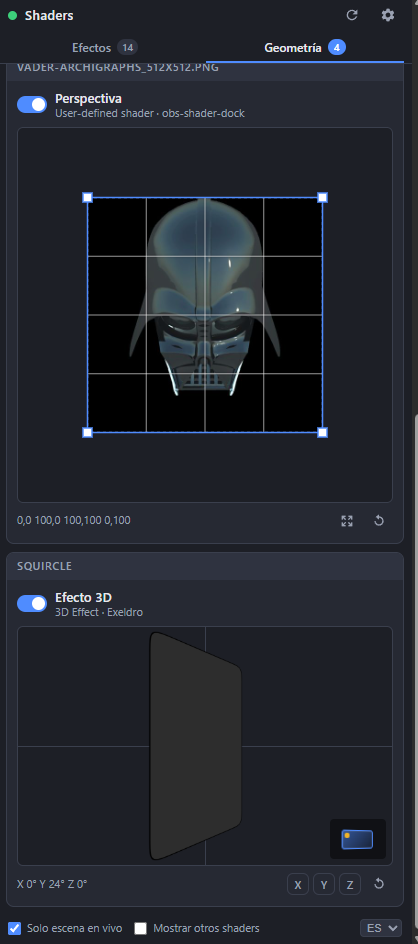

# obs-shader-dock

*A browser dock for OBS that finds your shader filters and gives each one play / start / end controls.*

Dock para **OBS Studio** que encuentra los filtros de shader de mis repos (obs-loving-spies, obs-retro-tv, obs-kr36, obs-liquid-glass, obs-modern-tv) en todas tus escenas y fuentes (o solo en la escena en vivo), y te da controles para cada uno sin abrir las propiedades del filtro.

> **¿Prefieres un plugin?** [Shader Dock](https://github.com/hjmeneses/shader-dock) es la versión nativa de este dock: se instala como plugin, no necesita WebSocket ni contraseña, toma los colores del tema de OBS y además controla [3D Effect 2](https://github.com/hjmeneses/obs-3d-effect), BFX 3D Rotation y [Light Trace](https://github.com/hjmeneses/light-trace). Este dock de navegador sigue funcionando y lee la misma lista de shaders.

*[English below](#english)*



<sub>La pestaña Geometría con los pads de Perspectiva y de 3D Effect. / The Geometry tab with the Perspective and 3D Effect pads.</sub>

## Qué hace

Dos pestañas: **Efectos** (secuencias y efectos continuos) y **Geometría** (3D Effect y Perspectiva). Cada una muestra cuántos filtros tiene y el dock recuerda la última que abriste.

- **Secuencias** (cañón, sangre, túnel, dimensión, teletransportador, títulos voladores):
  - ▶ **Iniciar**: apaga el bucle y corre la secuencia una vez, en la duración del filtro. El mismo botón la detiene.
  - ⏮ **Al principio** y ⏭ **Al final**: llevan el Progreso a 0 o a 100.
  - Una barra para mover el Progreso a mano, y la casilla **Bucle**.
- **Efectos continuos** (liquid glass, glitch, títulos con siluetas): interruptor para encender y apagar.
- **Transiciones** (emblema): no aparecen, porque son stingers y no filtros.
- **3D Effect** (el filtro [3D Effect](https://github.com/exeldro/obs-3d-effect) de Exeldro): un pad para girarlo con el mouse. El pad muestra la imagen de la fuente tal como sale al aire, ya girada, y se actualiza mientras arrastras; la tarjeta chica de la esquina indica la orientación.
  - Arrastrar gira en X/Y; con **Shift** gira en Z; con **Ctrl** lo mueve; la rueda lo acerca o aleja (posición Z).
  - Doble clic o el botón ↺ lo regresan a 0. Con el pad enfocado, las flechas giran de 5° en 5°.
  - Si mueves los sliders del filtro en OBS, el pad se pone al día.
- **Perspectiva** (`shaders/perspectiva.shader`, o `shaders/en/perspective.shader`): pone cada esquina de la imagen donde quieras, como Distorsionar y Perspectiva en Photoshop. El dock muestra la imagen de la fuente con cuatro anclas:
  - Arrastrar una esquina la mueve libre.
  - **Shift** + arrastrar: perspectiva. La esquina se mueve sobre un eje y la vecina del mismo lado se mueve en espejo.
  - Arrastrar adentro (o con **Alt**) mueve todo; doble clic o ↺ la regresan a su lugar.
  - La imagen se actualiza al soltar. Lo que salga del recuadro de la fuente se corta, porque el filtro dibuja en el tamaño de la fuente.
- La lista se actualiza sola cuando agregas, quitas o renombras filtros, fuentes o escenas. Si cambias el archivo `.shader` de un filtro, usa el botón de actualizar.
- **Mostrar otros shaders** incluye los filtros *User-defined shader* que no son de estos repos.
- **Solo escena en vivo** muestra solo los filtros de la escena al aire: los de la escena, sus fuentes, sus grupos y las escenas anidadas dentro de ella, a cualquier profundidad (las fuentes ocultas cuentan). En modo estudio incluye también la escena de vista previa. Si la escena no tiene filtros en esa pestaña, se muestran todos. La lista cambia sola al cambiar de escena.
- Con ese interruptor apagado, las fuentes de la escena en vivo van primero y marcadas en rojo (**En vivo**); las de la vista previa, en azul.
- **Idioma**: español o inglés con el selector ES/EN (la primera vez toma el idioma del sistema). Reconoce tanto los shaders en español como sus versiones en inglés de la carpeta `en/` de cada repo.

## Instalación

1. En OBS: **Herramientas → Ajustes del servidor WebSocket**. Activa el servidor y copia el puerto y la contraseña.
2. Descarga o clona este repo.
3. **Ver → Docks → Docks de navegador personalizados**. Ponle un nombre y en la URL pega la ruta del `index.html`:
   ```
   file:///C:/Users/tu-usuario/obs-shader-dock/index.html
   ```
4. La primera vez pide host, puerto y contraseña. Con **Recordar** marcado se guardan en el dock y la siguiente vez conecta solo. El engrane permite cambiarlos u olvidarlos.

No necesita servidor web ni internet: es un archivo local sin dependencias.

### Opcional: datos en la URL

`index.html?port=4455&password=...` conecta con esos datos sin preguntar. Útil si prefieres guardarlos en la configuración del dock de OBS en lugar del almacenamiento del navegador.

## Seguridad

- Con **Recordar**, la contraseña queda en texto plano en el almacenamiento local del navegador de OBS, dentro de tu perfil de usuario. Para un servidor WebSocket que solo escucha en tu PC es razonable; si no te convence, desmarca **Recordar** y la pedirá en cada arranque.
- El dock solo habla con el OBS del host que configures; no hace peticiones a ningún otro sitio.

## Agregar un shader nuevo

Edita `shaders.js` y agrega una línea con el nombre del archivo, la etiqueta, el tipo (`sequence`, `continuous` o `stinger`) y, para secuencias, la duración por defecto.

## Archivos

| Archivo | Qué es |
|---|---|
| `index.html` | El dock: estilos y estructura |
| `dock.js` | Búsqueda de filtros, controles y conexión |
| `obsws.js` | Cliente mínimo de obs-websocket 5 (sin dependencias) |
| `i18n.js` | Textos en español e inglés |
| `shaders.js` | Lista de shaders reconocidos |

Requiere OBS 28 o posterior (obs-websocket 5 integrado) y el plugin [obs-shaderfilter](https://github.com/exeldro/obs-shaderfilter).

---

## English

> **Prefer a plugin?** [Shader Dock](https://github.com/hjmeneses/shader-dock) is the native version of this dock: installed as a plugin, no WebSocket or password, follows the OBS theme, and also drives [3D Effect 2](https://github.com/hjmeneses/obs-3d-effect), BFX 3D Rotation and [Light Trace](https://github.com/hjmeneses/light-trace). This browser dock keeps working and reads the same shader list.

A custom browser dock for **OBS Studio** that scans every scene and source for shader filters from my repos and gives each one controls, split into two tabs, **Effects** and **Geometry**:

- **Sequences**: play once over the filter's duration (stops the loop), jump to start or end, scrub the progress bar, toggle loop.
- **Continuous effects**: on/off switch.
- **Transitions** (stingers) are not listed.
- **3D Effect** (Exeldro's [3D Effect](https://github.com/exeldro/obs-3d-effect) filter): a pad to rotate it with the mouse. Drag rotates X/Y, **Shift** rotates Z, **Ctrl** moves it, the wheel changes Z position; double-click or ↺ resets it. Changes made with the filter's sliders in OBS show up in the pad. The pad shows the source as it goes on air (already rotated), refreshed while you drag; the small card in the corner shows the orientation.
- **Live scene only**: lists just the filters in the program scene, including its groups and nested scenes (and the preview scene in Studio Mode). If the scene has none in that tab, everything is shown. With it off, live sources go first, marked red; preview sources are marked blue.
- **Perspective** (`shaders/en/perspective.shader`): corner pin, like Distort / Perspective in Photoshop. The dock shows the source image with four anchors: drag a corner freely, **Shift**-drag for perspective (the neighbouring corner mirrors it), drag inside or **Alt** to move everything, double-click or ↺ to reset. Anything outside the source bounds is clipped.

The UI is available in Spanish and English (ES/EN selector; the first time it follows the system language), and it recognizes both the Spanish shaders and their English versions from each repo's `en/` folder.

Install: enable the WebSocket server in OBS (**Tools → WebSocket Server Settings**), then add `file:///…/obs-shader-dock/index.html` under **View → Docks → Custom Browser Docks**. On first launch it asks for host, port and password; with *Remember* checked they are saved in the dock's local storage (plain text, local profile only). No web server, no internet, no dependencies.

To support another shader, add a line to `shaders.js`.

## License

MIT
